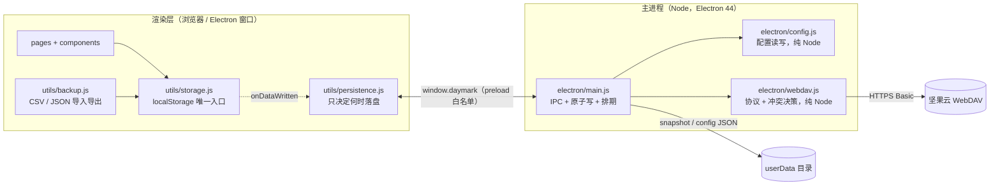

# DayMark 架构说明

面向改代码的人。README 讲「怎么用」，这里只讲**三条最容易改错的数据路径**以及它们为什么长成这样。每条论断都带 `文件:行号`，以代码为准；发现文档与代码不一致时，代码赢，且会把差异记在对应文档末尾。

## 先记住分层

依赖方向是单向的：`persistence → storage`。`storage.js` 只提供「数据变了」的订阅口，**不知道**有文件这回事。这条约束的原因写在[落盘时序](persistence.md)里——反向 import 曾让启动回填前的空快照盖掉本机真实数据。

桌面版可选，纯 Web 版（`index-standalone.html` 双击打开）里所有落盘与同步函数都是 no-op。

## 三份文档分别管什么

| 文档 | 覆盖 | 改它之前必须跑 |
|---|---|---|
| [落盘时序](persistence.md) | localStorage → `userData/daymark-snapshot.json`：回填、防抖、原子写、`beforeunload` 兜底 | `npm run verify:persistence` |
| [WebDAV 同步链路](sync.md) | 本机快照 ↔ 云端：`planPull` / `planPush` 决策、备份留档、路径编码、超时 | `npm run verify:webdav` + `npm run verify:config` |
| [统计口径](stats.md) | 完成率分母与「在册区间」（创建日 → 归档日前一天）、统计卡如何按月度/季度/年度区间取数、未来日排除、连续天数、归档与界面可见性、逾期判定、提醒排序、频率色阶 | `npm run verify:stats` + `npm run verify:todo` |

## 进程边界只有一道

渲染层与主进程之间只有 `electron/preload.cjs` 白名单暴露的 `window.daymark`（`contextIsolation: true`、`nodeIntegration: false`，`main.js:368-373`）。通道分两类：

- **异步（`ipcRenderer.invoke`）**：`load-snapshot` / `save-snapshot` / 配置 / `push-now` / `pull-now` / `test-connection`。
- **同步（`ipcRenderer.sendSync`）**：只有 `save-snapshot-sync` 一条，专供 `beforeunload`。理由写在[落盘时序](persistence.md#beforeunload-为什么必须走同步通道)。

主进程→渲染层的下行事件有三条：`daymark:sync-status`（状态与中文提示）、`daymark:apply-snapshot`（自动同步拉到较新数据）、`daymark:config-changed`。

## 数据落在哪里

| 内容 | 位置 | 生成者 |
|---|---|---|
| 运行时数据 | 浏览器 localStorage（4 个键，只在 `src/utils/storage.js` 的 `STORAGE_KEYS` 定义） | 渲染层 |
| 本机全量快照 | `<userData>/daymark-snapshot.json` | `main.js:81-88` `writeSnapshotRaw` |
| 本机配置（含密文密码） | `<userData>/daymark-config.json` | `electron/config.js` |
| 覆盖本机前的留档 | `<userData>/daymark-snapshot.conflict-<时间>.json` | `main.js:116-123` `writeLocalBackup` |
| 覆盖云端前的留档 | 云端同目录 `daymark-snapshot.cloud-<时间>.json` | `webdav.js:213-219` `pushBackup` |

Windows 上 `<userData>` 实际是 `%APPDATA%\daily-checkin-app\`——目录名取自 `package.json` 的 `name`，不是 `DayMark`。安装版与便携版共用同一个 `<userData>`，所以主进程持单实例锁（`main.js:475-485`）：双开会互相整份盖写快照文件。

**用户数据不在仓库里。** 仓库中没有种子数据、没有示例快照，`%APPDATA%` 也在 git 之外。

## 想改结构图

`daymark.dsl` 是同一套结构的 Structurizr DSL 源（C4 上下文 / 容器 / 组件三层视图），可用 Structurizr CLI 或 IDE 插件渲染；日常阅读用上面的 Mermaid 即可，GitHub 直接渲染。二者若与代码冲突，同样以代码为准。
