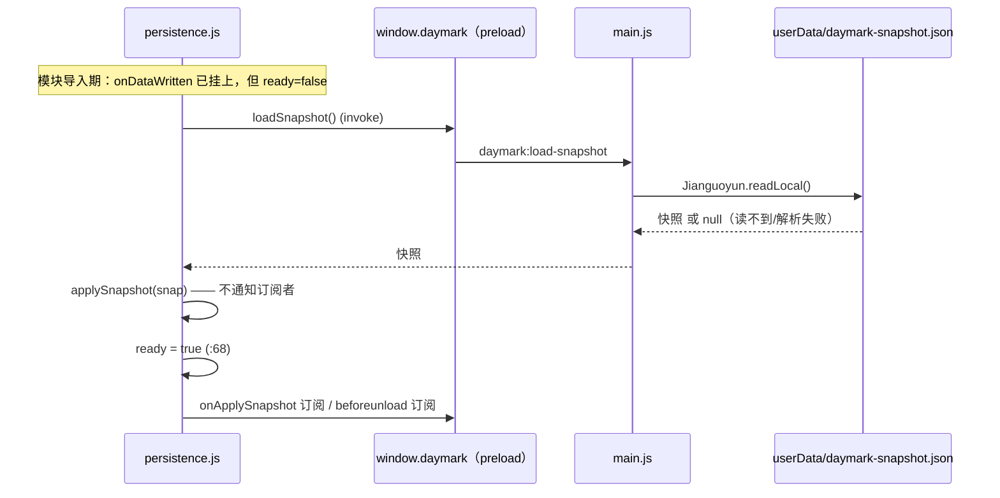

# 落盘时序：localStorage → 本机快照

一句话：**渲染层只负责「数据变了」，主进程只负责「怎么写」，中间那个「什么时候允许写」的闸门就是这份文档的主题。**

参与方：

| 模块 | 职责 | 不该做 |
|---|---|---|
| `src/utils/storage.js` | localStorage 唯一读写入口；写操作末尾通知订阅者（`:9-12`） | 决定落盘时机、import persistence |
| `src/utils/persistence.js` | 决定「何时落盘」：防抖、就绪闸门、`beforeunload` 兜底 | 读写具体键名 |
| `electron/main.js` | 执行动作：原子写文件、排期自动同步 | 参与「谁的较新」以外的判断 |
| `electron/preload.cjs` | 暴露 `window.daymark` 白名单 | 增加新的直通能力 |

## 依赖方向是反过来的

`persistence.js:13` 单向 `import { onDataWritten, buildSnapshot, applySnapshot } from './storage'`；`storage.js:9-12` 的注释写明了为什么不许反向 import：

> 数据访问层不该决定传输时序，否则模块导入期的 `migrateIfNeeded` 会在启动回填完成前就把未回填的 localStorage 写回文件。

`SCHEMA_VERSION = 2`（`storage.js:24`）在模块导入期就跑迁移，那时 localStorage 还是空的——如果 storage 自己触发落盘，就会写出一份「合法但为空」的快照，把本机真实数据整份盖掉。

订阅关系在模块加载期就挂好：`persistence.js:117` `onDataWritten(() => scheduleFlush())`。注册接口本身在 `storage.js:144`，某个监听器抛错不会中断其他监听器（`:164`）。

## 就绪闸门：`ready` 之前一律不写



三条关键行：

- `persistence.js:44` `scheduleFlush()` 开头 `if (!isElectronRuntime() || !ready) return;` —— 回填完成前的所有写库**直接被丢弃**，这是防住「空快照盖掉本机文件」的唯一闸门。
- `persistence.js:66-68`：`loadSnapshot()` 失败被 `.catch(() => null)` 吞掉后仍然照常置 `ready = true`。首次运行（无文件）与「读盘失败」在这里等价于「本机为空」，是有意为之：不能因为读盘抖动就永远不落盘。
- `storage.js:973-979`：`applySnapshot()` **故意不通知订阅者**。注释给了两个场景——启动回填时文件已是权威数据；云端拉取时主进程已写好文件。再通知一次只会用新时间戳把刚下载的数据回写、引发多余推送。它要求 `snap.exportDate` 存在，否则返回 `false`（`:980`）。

## 300ms 防抖与失败上报

`FLUSH_DEBOUNCE_MS = 300`（`persistence.js:15`）。连续改数据只落一次盘。

`persistence.js:48-55` 这段值得单独看：`saveSnapshot` 走 `invoke` 返回 Promise，**不接住就是完全静默失败**，用户以为已保存。所以代码显式 `Promise.resolve().then(...)`，`ok === false` 打 `console.error('snapshot flush rejected by main process')`，异常打 `snapshot flush failed`。主进程侧对应 `main.js:199-211`：写盘抛错时既 `setSyncState({status:'error', message:'本机保存失败：…'})` 又 `return false`，两条路都留着。

主进程写完才会排期自动同步（`main.js:208-209`）：只有 `hasCloudConfig(cfg) && cfg.autoSync` 才 `scheduleAutoPush`。

## beforeunload 为什么必须走同步通道

`invoke` 是异步的，而 `beforeunload` 不会等 Promise  resolve。关窗前 300ms 防抖窗口里的最后一笔改动如果走 `invoke`，窗口一关就没了。

- 渲染层：`persistence.js:76-78` 注册 `beforeunload` → `flushNow()`；`flushNow()`（`:30-40`）先清掉待发起的定时器，再调 `window.daymark.saveSnapshotSync(buildSnapshot())`，返回值必须严格 `=== true` 才算成功。
- preload：`ipcRenderer.sendSync('daymark:save-snapshot-sync', data)`（`preload.cjs:13`），同步返回。
- 主进程：`ipcMain.on(...)` 用 `event.returnValue` 回话（`main.js:215-227`），失败同样回报错误。

`isElectronRuntime()`（`persistence.js:24-27`）会检查 `saveSnapshotSync` 是不是函数，缺失即视为旧版桥不可用，退回「只有防抖落盘」的行为而不是报错——`flushNow` 与 `scheduleFlush` 都走这个判断。

## 原子写：先 `.tmp` 再同卷 `rename`

`main.js:76-88`：

```
mkdirSync(dir, {recursive:true})
writeFileSync(`${file}.tmp`, JSON.stringify(snap, null, 2))
renameSync(tmp, file)
```

注释给的理由：单步 `writeFileSync` 若中途崩溃或断电会留下**半截 JSON**，而 `Jianguoyun.readLocal`（`webdav.js:244-251`）把解析失败**当作「本机为空」返回 null**——于是一次自动同步就把「空」推上云端，把「空」定损成合法状态。`.tmp` + `rename` 在同目录（同卷）内是原子的：读到的要么是旧完整文件，要么是新完整文件。

`renameSync` 必须同卷，所以 `.tmp` 就放在目标文件旁边，不放系统临时目录。

## 冒烟探测为什么必须隔离 userData

`main.js:29-45`：`DAYMARK_SMOKE` 会写一份空快照做 IPC 探针。若不隔离，跑一次探测就把本机真实数据文件清空；而「本地为空」在同步决策里是**被允许的状态**（`planPush` 见 [同步链路](sync.md)），一次上传就把云端也带空。所以冒烟模式把 `userData` 重定向到 `%TEMP%\daymark-smoke-<ts>\`，并在 `will-quit` 删除。探针本身还校验「原子写后能原样读回」（`main.js:407-409`）。

## 谁锁住了这些行为

`.workbuddy/verify-persistence.mjs` 用桩替掉浏览器环境，断言：ready 之前不落盘、回填自身不触发落盘、防抖合并成一次、`beforeunload` 走同步通道、落盘失败被如实上报、云端快照应用后不产生回写、桥缺少同步通道时不误用。

改这条链路任何一处，先跑：

```bash
npm run verify:persistence   # 再跑 npm run verify 全量
```

## 已知文档差异

- `README.md` 的数据流图写作「localStorage ↔ daymark-snapshot.json（300ms 防抖 + 原子写）」，没有体现 `ready` 闸门。真正的风险不在防抖，而在回填完成前落盘——本节是准的。
- `src/utils/storage.js:968-971` 的 `buildSnapshot()` 把 `updatedAt` 置为 `exportDate`（同一时刻），而 `getAllData()`（`:955-963`）自己也写 `exportDate`。二者恒等，因此[同步链路](sync.md)里 `resolveLatest` 的「`updatedAt` 缺失时回落 `exportDate`」在当前实现下永远命中前者；回落分支是为读入外部/历史文件准备的，不是死代码。
