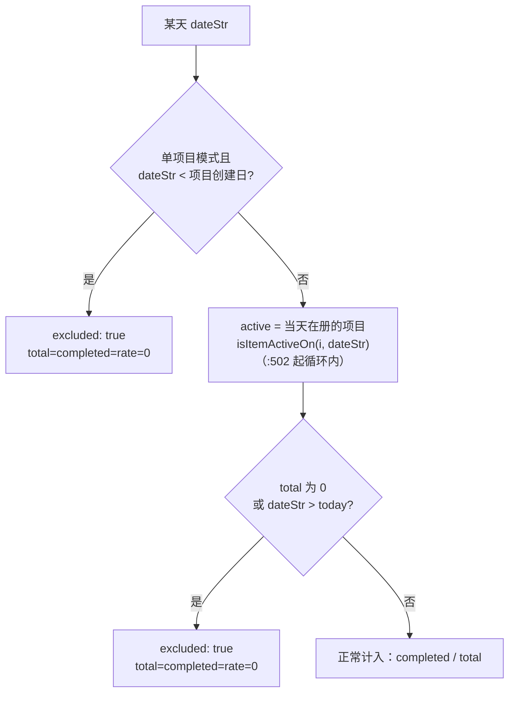

# 统计口径

打卡/待办应用最容易改错的部分不是数据写入，而是**「完成率」这个分母到底是谁**。口径变了，月/季/年视图、色阶热力图、连续天数会同时跟着变，而且错得很安静——数字仍然在 0–100 之间。

`src/utils/storage.js` 是唯一的口径实现，视图层只做汇总与着色。

## 口径的三条排除规则

`getMonthlyData(year, month, itemId)`（`storage.js:502`）逐日生成 `{ date, completed, total, rate, excluded? }`：



1. **分母只算「当天在册的打卡项」**：判定收敛在唯一入口 `isItemActiveOn(item, dateStr)`（`storage.js:135`）——`createdAt ≤ 当天`。晚建的项目不配在诞生前被记为「未完成」。
2. **归档日及以后同样不在册**：同一函数里 `archived` 为真时要求 `当天 < archivedAt`，即项目的在册区间是「创建日 → 归档日前一天」。归档当天起它不再进入任何分母，也不会把往年月份的数字追溯改写。已归档但没有归档日期（外来的脏数据）按「全程不在册」处理，宁可少算也不凭空拉低完成率。
3. **未到来的日子不参与统计**：`dateStr > today` 同样标 `excluded`。

三条规则同时被 `getCheckinStats`（`storage.js:473`，逐日分母）、`getMonthlyData`（在册判定在 `:531`）、`getOverallStats`、`getItemStats` 与 `CheckinCalendar` 消费。**不要在任何现场重写这套比较**，新需求请扩 `isItemActiveOn`。热力图与「当日完成 x/y」始终按这三条走；只有统计卡的季度 / 年度视图按下面的 `dayBasis:'period'` 跳过第 1、2 条（见「统计卡只算所选区间」）。

`excluded` 靠「加 0」生效：季/年视图**不重新判口径**，而是从月数据汇总——`getQuarterlyData`（`:563`）在 `:571` 调 `getMonthlyData`，`getYearlyData`（`:596`）在 `:602` 调用，各自 `reduce` 出月 `completed/total/rate` 与 `avgRate`。调用点在 `src/pages/CheckinPage.jsx` 的 `useMemo`。因为 `excluded` 那天的 `total` 与 `completed` 都是 0，聚合时「加 0」天然无贡献，**没人需要显式过滤 `excluded`**。跨年也不特殊：季度循环的月份恒在同一 `year`，跨年只发生在界面导航。

## 统计卡只算所选区间

`getViewRange(view, year, month, quarter)`（`storage.js:644`）把「月度 / 季度 / 年度」翻译成一个闭区间 `{ start, end, dayBasis }`（月末按真实天数，闰年 2 月为 `02-29`）。界面拿它去调 `getItemStats(itemId, range)`（`:778`）与 `getOverallStats(range)`（`:821`）；不传 range 即全生命周期（创建日 → 今天），1.x 的老调用点行为不变。

两者都汇入同一个实现 `statsFromRange(start, end, classify, meta)`（`:674`）——**全应用唯一的汇总统计出口**：

- `end` 一律裁剪到今天；`start > end`（区间整体在未来）直接返回 `empty: true`，四个指标全 0，界面显示「—」而不是「0%」。
- `classify(dateStr)` 返回 `done | miss | skip`。`skip`（不在册）的那天**既不进分母也不打断连续段**，所以「全部项目」里某天没有任何在册项目不会把连续切断。
- 区间与在册区间求交（仅 `dayBasis:'active'`）：单项目 `start = max(range.start, createdAt)`，因此月度视图的分母是「当月已到来的天数」而不是「创建日至今的总天数」。
- `meta` 由调用方补 `itemId / name / createdAt`，两个入口的返回结构同构。

### `dayBasis`：月度与季度/年度用的是两套分母基数（1.1.4 起）

| 视图 | `dayBasis` | 分母 | 项目 9-01 才创建，看 2026 Q3（7-01~9-30） |
|---|---|---|---|
| 月度 | `active` | 区间 ∩ 在册区间 ∩ 已到来 | 看 9 月 = 30 天 |
| 季度 / 年度 | `period` | 区间内**已过去的天数**，不看在册 | 92 天（完成 30 天 → 33%） |

改动起因：季度/年度也用 `active` 时，分母会被创建日、归档日裁成一小截，「这个季度过去了 92 天、你达成了几天」根本读不出来（今天看 Q4 更是和看 10 月得到同一个数字）。现在 `getItemStats` / `getOverallStats` 按 `range.dayBasis === 'period'` 决定两件事：起点直接取 `range.start`（不再抬到 `createdAt` / `earliestCreated`），以及「不在册」的日子从 `skip` 改成 `miss`；聚合口径里「当天没有任何在册项目」同样从 `skip` 改成 `miss`。

边界仍然只有一处：`statsFromRange` 不认识 `dayBasis`，它只管一天天走过去、照 `classify` 的结果记账，**「这天算不算在册」的问题留在两个调用方**——因为那需要读 `isItemActiveOn` 与项目数组，把数组塞进逐日循环器等于让统计实现同时决定口径和遍历。未来的日子在两套基数下都被 `end` 裁掉，所以 `period` 不是「把 12 月也算进 Q4」；区间整体在未来仍然 `empty`。连续段则由 `miss` 参与切断：Q3 里 7、8 月那 62 天是实打实的未完成，不会像月度口径那样被当成「还没开始」。回归见 `verify:stats` 场景 J（季度/年度按区间天数）与场景 L（过去整季 92 天、过去整年 365/366 天，同项目的月度仍是 30 天且 100%，聚合分母与单项目对齐，未来季度仍为空）。


## 不变式：单项目 `total` 之和 == 聚合 `total`

改分母时最该守住的一条。`.workbuddy/verify-stats.mjs` 场景 I 逐日断言两者相等（`:292` 比 total、`:293` 比 completed），并在 `:304` 明确断言分母**不是**「天数 × 项目数」；场景 K 又对「一个在册 + 一个已归档」的组合重复了同一条对齐断言，场景 L 则在 `period` 基数下重复一次（季度的单项目分母 92 == 聚合分母 92）。

```bash
npm run verify:stats
```

## 连续天数：不能用循环结束时的 `running`

`statsFromRange`（`storage.js:674`）里的当前连续判定（`:740-741`）：

```
streakEnd === end || streakEnd === formatDate(prevDay) ? streakEndRun : 0
```

`end` 是**裁剪到今天的区间末**，`prevDay` 是它的前一天。配套变量 `streakEnd` / `streakEndRun` 在 `:713` 声明、`:726-727` 与命中日同步更新。

`:711-712` 的注释解释了为什么不能用循环结束时的 `running`：**区间末当天还没打卡时 `running` 已经被重置为 0**，而「当天未打卡但前一天连着」按产品语义不算中断。这条语义由 `verify-stats` 的场景 C（今天未打卡、昨天连着）与场景 A（连续段已断在两天前）、场景 G（聚合口径）、场景 J（连续段按区间截断）锁住。

区间截断是 1.1.2 起的行为：月度视图的最长连续不会超过当月在册天数；查看历史月份时，「当前连续」表示**截至该区间末尾**的连续段，而不是把今天的实时值搬过去。统计卡下方会跟着显示 `统计区间：起 ~ 止`，让数字的口径写在脸上。`period` 基数（季度 / 年度）只放大分母，不动分子：项目 9-01 创建、之后天天达成，看上一年仍是「连续 30 / 分母 365」。

## 归档与界面可见性

归档是**同一份数组上的两个字段**（`archived` / `archivedAt`），不是新的存储键，因此 `getAllData()`、`applySnapshot()`、快照落盘与 WebDAV 同步都不用改——字段是随对象整体搬运的。要盯着的是这三处：

| 落点 | 位置 | 漏掉的后果 |
|---|---|---|
| 界面取数 | `getActiveCheckinItems()`（`storage.js:322`）/ `getActiveTodos()`（`:905`） | 页面仍用 `getCheckinItems()` / `getTodos()` → 归档项照常显示 |
| 备份重建 | `normalizeTodo()`（`:1118`）与 `setAllData()`（`:1329`）的打卡项重建都是**白名单** | 归档状态在「导出 → 恢复」后被抹掉，归档项自己冒回界面 |
| CSV 区块 | `src/utils/backup.js` 的 `ITEM_HEADERS` / `TODO_HEADERS` 与对应解析 | 只导出不解析，恢复时同样丢；旧备份缺列要能安全回落为未归档 |

另有两处反面教材式的路径，改动时请一并检查：

- `reorderCheckinItems()`（`:410`）与 `reorderTodos()`（`:1058`）：界面只会传「可见项」的 id，**不能**拿传入列表当整组数据写回，否则一次拖拽就把归档项从存储里抹掉。两个函数现在都是「先按传入顺序排，再把没点到的按原顺序追加」。
- 归档 / 取消归档（`:338` / `:349` / `:921` / `:932`）：取消归档时是 `delete` 掉两个字段，而不是写 `false` / `''`。这样恢复后的项目与「从未归档过」逐字节等价，不会再被任何 `archived` 分支绊到。

概览与归档清单的数据源在 `src/utils/backup.js`：`getDataOverview()`（`:550`）的 `itemCount` / `todoCount` 只数未归档（界面看得见的那部分），归档量走 `archivedItemCount` / `archivedRecordCount` / `archivedTodoCount` 三个独立字段；`getArchiveInventory()`（`:612`）为「数据管理 → 归档」提供带历史条数的清单，`groupArchiveByMonth()`（`:658`）是按月分组的唯一实现。

## 「已过期」只有一个判定

`isPastDue(completed, dueDate, todayStr)`（`storage.js:112-114`）：

```js
!completed && !!dueDate && String(dueDate) < String(todayStr)
```

**`!!dueDate` 不能省。** `:106-108` 给了理由：`YYYY-MM-DD` 字符串比较里，空串小于任何日期，直接写 `dueDate < todayStr` 会把**所有没有截止日的待办**标成过期。别在现场重写这套比较。

## 提醒列表：一个排序键，两条完成项退场规则

`getUpcomingPhases(withinDays = 7, todayStr = getToday())`（`storage.js:88-105`）：

- 只遍历 `getActiveTodos()`（`:90`），归档待办连同它的行动一起退出提醒；
- 剔除已完成待办（`:91`）与无截止日的行动（`:93`）——**但不剔除已完成的行动**；
- 剔除今天到期与超出向前窗口的（`:95`）；已完成的两条退场判定在 `:97`（补做）与 `:98`（回看窗）；
- `daysLeft = daysBetween(todayStr, dueDate)`（`:94`），**逾期为负数**；
- 比较器只有一处：`:103` 的 `a.daysLeft - b.daysLeft || title.localeCompare(title)`。逾期自然置顶，不需要单独的「逾期分组」，也不给完成项单独排位——把完成项"沉底"会让刚勾掉的那一行跳到别处。

1.1.4 起 `daysLeft === 0` 不进提醒：日程页右栏的「行动」分组本来就按选中日列出当天到期的行动，选中「今天」时两者完全重合，同屏再抄一遍只会把真正要往前看的项挤出视野。数据本身没有任何变化——那些行动仍然挂在同一个 `phase.dueDate` 上，只是换了展示位置，所以「提醒（N）」的计数会相应减少。

**已完成项的去留取决于「哪天勾的」，不是「勾没勾」**。要分得开就必须有完成日期，所以 `toggleTodoPhase`（`storage.js:1083`）在 `completedTime`（HH:mm，界面显示用）之外还写 **`phase.completedAt`（YYYY-MM-DD，判定用）**，取消完成时两者一起归零：

| 情况 | 判定 | 结果 |
|---|---|---|
| 按时 / 提前勾掉 | `completedAt ≤ dueDate` | 留在列表里划掉变灰；仍受向前 `withinDays` 天的回看窗约束（`:98`） |
| 逾期之后才补做 | `completedAt > dueDate` | **直接不显示**（`:97`）——提醒负责「还没做」，一次迟到的补做既不该继续标红，也不该在灰色里长期占位 |
| 老数据 / 旧备份 | 没有 `completedAt` | 判不出是否补做，退回上一行的窗口规则；既不当成补做抹掉，也不拿今天或导出当天冒充 |

界面侧 `ReminderRow`（`SchedulePage.jsx:168`）读 `phase.completed` 画完成态：按时勾掉的那行**位置、行高、条数都不变**，与其他分区的完成效果一致（标题划线 + 变灰、勾选框变绿）；只有逾期补做的会整行退出，这是本人明确要求的例外，别顺手把按时的也删掉。`overdue` 字段只描述截止日与今天的关系（已完成项也可能为 `true`），界面对完成项一律用灰色、不再标红。

这个字段要活着走完四处白名单：`addTodo`、`editTodo`、`normalizeTodo`（`:1118`，非法值归零）与 `AddTodoDialog` 提交时的原值回传——对话框不显示它，漏传一次就把「补做」洗成「按时」，所以 `verify:todo` 第 9 组按 `verify:config` 的做法用源码断言锁住这条接线。CSV 侧 `formatPhases` / `parsePhases`（`backup.js:165` / `:180`）把它编进阶段串 `[已完成@截止日]名称 (完成日期 完成时刻)`，旧备份只有 `(HH:mm)` 时读回空日期。

改窗口、改排序、改「谁进提醒 / 完成项怎么取舍」都去扩 `verify:todo` 第 6 组与第 9 组（今天到期被排除、按时完成的留原位、补做的退出、老数据退回窗口规则、完成日期随勾选写入并随取消清零；归档排除锁在第 7 组，CSV 日期往返锁在 `verify:backup` 第 12 组），不要在页面里另写一套。

## 日期一律是本地日

`getToday()`（`:54-60`）、`formatDate()`（`:151-157`）都用 `getFullYear/getMonth/getDate`，**没有 UTC 换算**；`daysBetween` 把 `${date}T00:00:00` 当本地零点解析（`:63-68`）。口径全部建立在「同一台机器的本地日」上，跨时区设备之间的比较不在设计范围内。

## 两套颜色，不许混

| 用途 | 实现 | 色相 |
|---|---|---|
| **完成频率色阶**（热力图、进度条） | `src/utils/colors.js:15-22` `getRateColor(rate)` | 纯蓝，`h=213` 固定（`:18`），`s = 60+35t`（`:19`）、`l = 22+36t`（`:20`），`t = clamp(rate,0,100)/100`（`:17`） |
| **无数据 / 0%** | `RATE_COLOR_NONE = '#161b22'`（`colors.js:13`） | `rate == null \|\| rate <= 0` 时返回（`:16`）；月历不再自己写死这个色 |
| **不参与统计（excluded）** | `CheckinCalendar.jsx:72-76`、图例 `:112-115` | 无填充色：`bgcolor: transparent` + 虚线边框，与「0%」的实心 `#161b22` 区分开 |
| **状态语义（打卡成功、勾选完成）** | `CheckinItem.jsx:124`、`TodoCard.jsx:177` / `:322`、`CheckinPage.jsx:64`（StatCell highlight）与 `:352`（「今天」标签）、`SchedulePage.jsx:64` | 绿 `#3fb950` |
| **日程页分区标题** | `SchedulePage.jsx:524`（打卡）/ `:525`（待办）/ `:526`（行动） | 绿 `#3fb950` / 琥珀 `#d29922` / 蓝 `#58a6ff` |
| **日程页「提醒」** | `SchedulePage.jsx:41` `REMINDER_COLOR`（标题）、`:43` `#d2a8ff`（明天到期）、`:45` `#a371f7`（N 天后）；完成态在 `ReminderRow`（`:168`）取 `done ? '#6e7681'`（`:172`） | 紫色系，1.1.4 起与上面三个分区色错开；段内只留红 `#f85149` 表达「已逾期」（`:158`），沿用本页红色只作状态语义的既有约定。**已完成的一律转灰**（标题 `#6e7681` + 划线、勾选框 `#3fb950`），既不标红也不标紫——灰就是这一页的「做完了」 |

频率色阶的调用点：`CheckinCalendar.jsx:76`、`QuarterlyChart.jsx:65`、`YearlyChart.jsx:64`、`CheckinPage.jsx:393`（今日进度条）。改配色只动 `colors.js` 与这几个调用点，**不要回到分档硬编码，也不要给频率引入青/绿**——紫色是给「分区身份」用的，不是给完成率用的。

## 已知问题与文档差异（这一节是现状，不是目标）

1. **`getRateGradient()`（`colors.js:25-28`）在 `src/` 内没有任何调用点**；实际图例是 5 档离散色块 `[10,30,50,70,90]`（`CheckinCalendar.jsx:118-120`）。
2. 热力图里「完成率 0%（在册但一次没打）」与「项目当天还没创建」仍是两种含义，前者实心 `#161b22`、后者虚线空格——月历已经分开了，`QuarterlyChart` / `YearlyChart` 的柱状图没有「不参与」的表达，只是把 0 当成矮柱子。
3. `AGENTS.md` 称「`getMonthlyData` 是唯一的口径实现」——从 1.1.2 起对月历热力图也成立（它改成直接消费 `getMonthlyData` 的输出，含 `excluded`）；汇总统计那一侧的唯一实现则是 `statsFromRange`，两者共用 `isItemActiveOn`。
4. 月历热力图与月/季/年柱状图**仍按 `active` 基数**（`getMonthlyData` 的三条排除规则），只有统计卡的季度 / 年度用 `period`。所以同一个季度里，柱状图上的月度 `total` 相加会小于统计卡的季度分母——两处回答的是不同的问题（「这些天里打过多少次卡」vs「这段日子你达成了几天」），不是缺陷，但别把它当成对齐不变式去"修"。

> 历史条目（1.1.1 及之前）：月历热力图曾自己算一套口径（只排除创建日之前，不排除未来日、不读 `excluded`），并且硬编码 `'#161b22'`。1.1.2 已修掉，做法正是「消费 `getMonthlyData` 而不是把 filter 抄一遍」，回归由 `verify:stats` 的场景 K 锁住。
