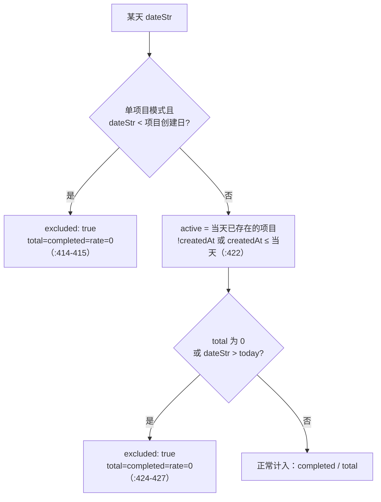

# 统计口径

打卡/待办应用最容易改错的部分不是数据写入，而是**「完成率」这个分母到底是谁**。口径变了，月/季/年视图、色阶热力图、连续天数会同时跟着变，而且错得很安静——数字仍然在 0–100 之间。

`src/utils/storage.js` 是唯一的口径实现，视图层只做汇总与着色。

## 口径的两条排除规则

`getMonthlyData(year, month, itemId)`（`storage.js:395`）逐日生成 `{ date, completed, total, rate, excluded? }`：



1. **分母只算「当天已经存在的打卡项」**：`storage.js:422` 的 `list.filter((i) => !i.createdAt || i.createdAt.slice(0,10) <= dateStr)`。晚建的项目不配在诞生前被记为「未完成」。
2. **未到来的日子不参与统计**：`dateStr > today` 同样标 `excluded`（`:424`）。

`:419-421` 的注释写了不改的后果：多项视图里晚建的项目会**系统性拉低**完成率，跨年视图更是把整个未来月份算成一堆 0%。

单项目模式的统计起点是项目创建日（`:403-407` 的 `sinceDate`）；`itemId` 不传时行为与历史一致（`:392`）。

## `excluded` 靠「加 0」生效，渲染层不读它

季/年视图**不重新判口径**，而是从月数据汇总：`getQuarterlyData`（`:454`）在 `:462` 调 `getMonthlyData`，`getYearlyData`（`:487`）在 `:493` 调用，各自 `reduce` 出月 `completed/total/rate` 与 `avgRate`（`:467-479`、`:498-509`）。调用点在 `src/pages/CheckinPage.jsx:111` 与 `:115` 的 `useMemo`。

因为 `excluded` 那天的 `total` 与 `completed` 都是 0，聚合时「加 0」天然无贡献，**没人需要显式过滤 `excluded`**。跨年也不特殊：季度循环的月份恒在同一 `year`（`:455`、`:460`），跨年只发生在界面导航（`CheckinPage.jsx:266-284`，12 月→次年 1 月、Q4→次年 Q1）。

代价是 `excluded` 字段目前只有 `verify-stats` 在断言（`.workbuddy/verify-stats.mjs:76-79`、`:247`、`:250`），界面组件一个都不读。想区分「不参与」和「0%」，必须自己消费这个标记，别指望颜色。

## 不变式：单项目 `total` 之和 == 聚合 `total`

改分母时最该守住的一条。`.workbuddy/verify-stats.mjs` 场景 I 逐日断言两者相等（`:258` 比 total、`:259` 比 completed），并在 `:270` 明确断言分母**不是**「天数 × 项目数」。

```bash
npm run verify:stats
```

## 连续天数：不能用循环结束时的 `running`

`getItemStats(itemId)` 的当前连续判定（`storage.js:576-581`）：

```
streakEnd === today || streakEnd === yesterdayStr ? streakEndRun : 0
```

配套变量 `streakEnd` / `streakEndRun` 在 `:549-552` 声明、`:566-567` 与命中日同步更新；聚合口径里同一对变量在 `:647-648` 与 `:659-660`，判定在 `:669-674`。

`:550-551` 的注释解释了为什么不能用循环结束时的 `running`：**今天还没打卡时 `running` 已经被重置为 0**，而「今天未打卡但昨天连着」按产品语义不算中断。这条语义由 `verify-stats` 场景 C（`:151-169`，断言在 `:167`）与场景 A（`:123`）、场景 G（`:218`）锁住。

## 「已过期」只有一个判定

`isPastDue(completed, dueDate, todayStr)`（`storage.js:91-93`）：

```js
!completed && !!dueDate && String(dueDate) < String(todayStr)
```

**`!!dueDate` 不能省。** `:88-89` 给了理由：`YYYY-MM-DD` 字符串比较里，空串小于任何日期，直接写 `dueDate < todayStr` 会把**所有没有截止日的待办**标成过期。别在现场重写这套比较。

## 提醒列表：一个排序键

`getUpcomingPhases(withinDays = 7, todayStr = getToday())`（`storage.js:71-84`）：

- 剔除已完成待办（`:74`）、已完成或无截止日的行动（`:76`）、超出窗口的（`:78`）；
- `daysLeft = daysBetween(todayStr, dueDate)`（`:77`），**逾期为负数**；
- 比较器只有一处：`:82` 的 `a.daysLeft - b.daysLeft || title.localeCompare(title)`。逾期自然置顶，不需要单独的「逾期分组」。

改窗口或改排序都去扩 `verify:todo` 第 6 组，不要在页面里另写一套。

## 日期一律是本地日

`getToday()`（`:49-55`）、`formatDate()`（`:100-105`）都用 `getFullYear/getMonth/getDate`，**没有 UTC 换算**；`daysBetween` 把 `${date}T00:00:00` 当本地零点解析（`:58-63`）。口径全部建立在「同一台机器的本地日」上，跨时区设备之间的比较不在设计范围内。

## 两套颜色，不许混

| 用途 | 实现 | 色相 |
|---|---|---|
| **完成频率色阶**（热力图、进度条） | `src/utils/colors.js:15-22` `getRateColor(rate)` | 纯蓝，`h=213` 固定（`:18`），`s = 60+35t`（`:19`）、`l = 22+36t`（`:20`），`t = clamp(rate,0,100)/100`（`:17`） |
| **无数据 / 0%** | `RATE_COLOR_NONE = '#161b22'`（`colors.js:13`） | `rate == null \|\| rate <= 0` 时返回（`:16`） |
| **状态语义（打卡成功、勾选完成）** | `CheckinItem.jsx:122`、`TodoCard.jsx:175` / `:308`、`CheckinPage.jsx:63`（StatCell highlight）与 `:340`（「今天」标签）、`SchedulePage.jsx:48` | 绿 `#3fb950` |

频率色阶的调用点：`CheckinCalendar.jsx:76`、`QuarterlyChart.jsx:65`、`YearlyChart.jsx:64`、`CheckinPage.jsx:381`。改配色只动 `colors.js` 与这几个调用点，**不要回到分档硬编码，也不要给频率引入青/绿**。

## 已知问题与文档差异（这一节是现状，不是目标）

以下是本次读代码发现的、当前实现与 `AGENTS.md` / 设计意图不一致的地方，按严重度排：

1. **月历热力图自己算了一套口径**（`CheckinCalendar.jsx:29-43`）。它只排除「项目创建日之前」（`:37`），**不排除未来日、也不读 `excluded`**。于是未来某天若已有项目存在，会得到 `total>0 / completed=0 / rate=0` → 被涂成 `#161b22`，视觉上与「已完成 0%」完全同色，而按 `getMonthlyData` 的口径这天根本不该参与统计。月历与「汇总统计」数字来自两套计算，这是当前最容易复发的一致性缺陷。
2. **`RATE_COLOR_NONE` 没被复用**：`CheckinCalendar.jsx:76` 硬编码 `'#161b22'`，`colors.js` 里的常量只在 `colors.js:16` 自用。改「无数据」色时只改常量会漏掉月历。
3. **`getRateGradient()`（`colors.js:25-28`）在 `src/` 内没有任何调用点**；实际图例是 5 档离散色块 `[10,30,50,70,90]`（`CheckinCalendar.jsx:112-114`）。
4. **「无数据」与「完成率 0%」不可区分**：两者都落到 `#161b22`。设计说明里称该色用于「与低完成率区分」，而月历/热力图里没有第三种中性色表示「无数据」。
5. `AGENTS.md:22` 称「`getMonthlyData` 是唯一的口径实现」——对季/年视图成立，对月历热力图**不成立**（见第 1 条）。

修第 1 条的正确做法是让 `CheckinCalendar` 消费 `getMonthlyData` 的输出（含 `excluded`），而不是把那段 filter 抄一遍；改完必须同时跑 `verify:stats`。
