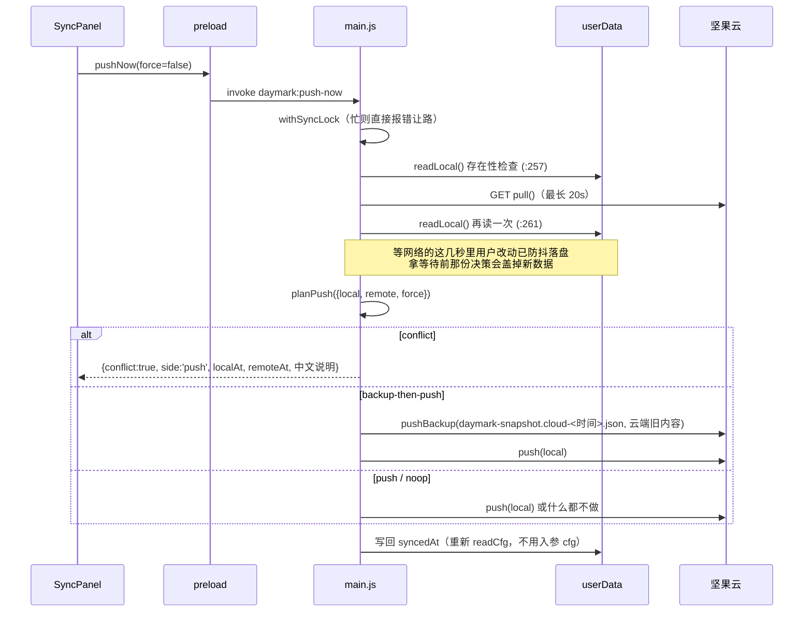

# 坚果云 WebDAV 同步链路

**「只在会丢掉较新一方时动手，且动手前先留档」**——这句话是整个同步模块的策略，实现被切成两半：

- `electron/webdav.js` 里是**纯决策**（`planPull` / `planPush` / `resolveLatest`），无 Electron、无窗口、可脱离桌面环境直接回归；
- `electron/main.js` 里是**纯执行**（读写文件、发 IPC、排期），不再自己判断谁的较新。

新增需求请扩那两个纯函数并补 `verify:webdav` 用例，不要把判断写进 IPC handler。

## 协议与常量

| 常量 | 值 | 位置 | 为什么在这 |
|---|---|---|---|
| `DEFAULT_BASE` | `https://dav.jianguoyun.com/dav/` | `webdav.js:17` | 界面「WebDAV 服务器」留空即用它 |
| `DEFAULT_DIR` | `DayMark` | `:18` | 云端目录名 |
| `REQUEST_TIMEOUT_MS` | `20000` | `:20` | 没有超时，网络半开会界面永远停在「处理中…」 |
| `SNAPSHOT_FILENAME` | `daymark-snapshot.json` | `:21` | 主快照；本机与云端同名 |
| `BACKUP_NAME_RE` | `/^daymark-snapshot\.(conflict\|cloud)-[\dT-]+\.json$/` | `:23` | 只匹配留档文件名，**主快照永远不在清理范围内** |

坚果云语义：`MKCOL` 建目录（已存在返回 405/409）、`PUT` 覆盖、`GET` 取回、`401` 认证失败、`404` 文件不存在（`webdav.js:4-9`）。认证是 `Basic base64(注册邮箱:应用密码)`（`:64`），这里的应用密码专指**用于授权第三方 WebDAV 应用访问的 16 位随机应用密码**，统一称谓是 `APP_PASSWORD_NAME`（`:24`）。

## 地址拼接：必须逐段编码

`normalizeWebdavDir`（`webdav.js:46-57`）只纠正分隔符写法：反斜杠换成 `/`、去首尾斜杠与空白、合并空段。**它刻意不删任何层级**——WebDAV 根对应网页里的哪一层各家习惯不同，1.1.3 曾在这里擅自剥掉开头的「我的坚果云」，把本来填对的配置改错了（回归里锁了这条反例）。填错不靠猜，交给 `checkConnection()` 去云端问。`encodeWebdavPath`（`:60-66`）在其之上按 `/` 切开 → **每段单独 `encodeURIComponent`** → 重拼；`buildRemoteUrl`（`:71`）保证 base 以 `/` 结尾、目录段已编码、文件名也编码。`mergeConfigInput`（`config.js`）保存时同样调用 `normalizeWebdavDir`，所以盘上那份与请求用的那份一致。

不这么做的后果写在注释里：坚果云目录名允许空格、`#`、中文，不编码会让 URL 变形（空格截断、`#` 之后被当片段），表现为**莫名的 404**。任何新增的远端地址拼接都必须走这两个函数。

`Jianguoyun` 构造时同时算好 `this.url`（主快照）与 `this.dirUrl`（目录，结尾不带斜杠，`:174-178`），留档文件用 `urlFor(fileName)` 放在**同目录**（`:182-184`）——不建子目录，免去二次 `MKCOL`。

## 谁的较新：`resolveLatest`

`webdav.js:88-96`：

```
无云端 → 'local'      无本机 → 'remote'
t(s) = s.updatedAt || s.exportDate || ''     // 字符串比较
相等 → 'equal'，否则较大的一方
```

快照的 `updatedAt` 是本地/云端比对的**唯一依据**，任何生成快照的新路径都必须带上它（`storage.js:1239-1242` 在 `buildSnapshot()` 里补 `updatedAt`）。

## 决策表

`planPull({local, remote, force})`（`webdav.js:105-112`）与 `planPush(...)`（`:118-125`）都只返回动作名：

| 情形 | `planPull` | `planPush` | 是否留档 |
|---|---|---|---|
| 云端为空 | `empty-cloud` | `push` | 否（覆盖的是空） |
| 本机为空 | `apply` | `no-local` | 否 |
| 云端较新 | `apply` | `conflict`（不 force） | 下载不留档：本机那份本来就较旧 |
| 本机较新 | `conflict`（不 force） | `push` | 上传不留档：云端那份本来就较旧 |
| 同一份 | `noop` | `noop` | 不涉及 |
| 冲突且 `force` | `backup-then-apply` | `backup-then-push` | **是，覆盖前先留档** |

两个「为空」方向是不对称的：`planPush` 遇到本机为空返回 `no-local` 而不是硬推——防止把「空」当成数据推上云端；`planPull` 遇到云端为空返回 `empty-cloud`，主进程据此提示「云端暂无数据文件」（`main.js:310-313`）。

## 手动上传（点「立即上传」）



`main.js:251-300`。三个要点：

1. **读本地在 `await` 网络之后**（`:259-261` 两次 `readLocal`）。`withSyncLock` 只互斥同步任务之间，管不到渲染层落盘；先读本地再等 20 秒，等待期间的改动就已落盘，拿旧快照决策会把新数据**无备份地**盖掉。`runSync` 里同样的顺序约束写在注释 `:143-145`。
2. **冲突时不覆盖，返回结构化结果**（`:264-274`）：`conflict/side/localAt/remoteAt/error`，界面据此决定要不要再发一次 `pushNow(true)`。
3. **`syncedAt` 一律重新 `readCfg()` 再写**（`:276-278`、`:290-292`、`:184-187`）。用调度时捕获的 cfg 回写，会把用户这几秒里改的账号/目录/服务器覆写回去。

## 手动下载

`main.js:302-354`，与上传对称，差别在两个地方：

- 强制下载时先 `writeLocalBackup(local)`（`:337-340` → `:116-123`）把本机较新一份存成 `daymark-snapshot.conflict-<时间>.json`，再 `writeSnapshotRaw(remote)` 覆盖，然后 `pruneBackups(dir)` 只留最近 10 份（`webdav.js:141-166`，按 mtime 倒序，超出部分删除；单个删除失败不影响主流程）。
- **不自动刷新界面**（`:346-348`）：把快照交回渲染进程，由它写入 localStorage 后再提示用户刷新。注释给的理由是reload 会打断阅读留档路径提示，也避免旧内存数据回写覆盖刚下载的文件。渲染层的接收端在 `persistence.js:71-73`（自动同步路径）：`applySnapshot(remote)` 成功才 `window.location.reload()`。

## 自动同步：只做「把较新的那份同步到双方」

`scheduleAutoPush`（`main.js:173-192`）由每次成功落盘触发（`:208-209`），延迟 **5 秒**合并连续改动；触发前先查 `hasCloudConfig(cfg) && cfg.autoSync`。

- 锁被占用时**重新排期而不是丢弃**（`:177-180`）。
- 内部走 `runSync`（`:141-171`）：先 `pull` 取云端、**再**读本机（`:146-147`，顺序同上），然后 `planPull` → `apply` 分支落盘并 `send('daymark:apply-snapshot')`，否则 `planPush` → `push` / `noop`，本机为空才报错「本地没有可上传的数据」（`:170`）。
- 不带 `force`，所以自动同步永远不会出现 `backup-then-*`（`:151` 注释）——较旧一方被覆盖前不涉及留档。

## 并发：一次只允许一个同步

`withSyncLock`（`main.js:130-138`）用一个 `syncBusy` 布尔量，忙时抛「已有同步任务在进行，请稍候再试」，`finally` 复位。它挡的是手动推/拉与自动同步交错读写同一份快照。

新增同步入口必须包在锁里，并想清楚「锁被占用时是重新排期（如自动同步）还是回报用户（如手动）」。

## 配置侧：密码不进文件、不进界面回显

`electron/config.js` 是纯 Node，字段见 `DEFAULT_CONFIG`（`:14-21`）：`account` / `password` / `server` / `dir` / `autoSync` / `syncedAt`。

| 规则 | 实现 |
|---|---|
| 界面密码留空 = 保持原密码 | `mergeConfigInput` `:140-143`，非空才 `trim()` 覆盖 |
| `syncedAt` 不接受界面输入 | `mergeConfigInput` 返回对象里没有 `syncedAt`，只从 `...current` 继承（`:136-147`） |
| 界面输入一律 `trim()`，`dir` 空则回落 `DayMark` | `:139-145` |
| 回显抹掉密码 | `publicConfig` `:155-158` 解构扔掉 `password` / `passwordEnc`，只给 `passwordSet: !!password` |
| 是否算「配好了云」 | `hasCloudConfig` `:150-152` 要求 `account && password` 都非空 |
| 密文落盘 | `writeConfig` `:96-102`：有明文且 codec 可用时写 `passwordEnc`（base64）并把 `password` 置空 |
| **本次没有明文时绝不能抹掉已有密码** | `writeConfig` `:103-123`：回头读盘，优先保留 `passwordEnc`，只有旧明文时顺手迁成密文（`:113-116`）。老实现只在 codec 不可用的分支做保留，**加密可用 + 空明文会把密文写成空串**，用户被迫重填、重填时常填成登录密码，之后每次同步都停在 401 |
| 内存里保留明文 | `readConfig` `:59-84`：优先解 `passwordEnc`，明文只在内存对象里流转 |
| 解不开就视为未配置 | `:66-72`，宁可让用户重填，也不要拿乱码去同步再报一个看不懂的 401 |
| 换机器/无 keyring 的降级 | codec 不可用时 `:100-101` / `:117-118` 才退回明文；`main.js:61-71` 的 codec 由 Electron `safeStorage`（Windows DPAPI，绑当前用户账户）提供 |
| 配置文件也是原子写 | `writeConfig` `:126-129` `.tmp` + `renameSync`，与主快照同一策略 |

**注意 `DEFAULT_CONFIG`、`readConfig`、`mergeConfigInput` 三处都要同步补字段**，否则新字段会被静默丢弃——「WebDAV 服务器」字段就踩过这个坑（`server` 必须一路贯通到 `buildRemoteUrl` 的 `baseUrl`，见 `main.js:106`）。

## 错误提示统一在 `describeHttpError`

`webdav.js:207-222` 把状态码翻译成中文：`401` 认证失败、`403` 权限不足、`404` 文件/目录不存在、`405/409` 路径不存在或已存在、`507` 空间不足，其余 `失败（HTTP <code>）`；第三参数 `detail` 统一以「。…」附在句尾。超时与网络错误在 `webdavRequest` 里就地翻译（`:141-144`）。`pull` 把 `404` 与 `409` 一并归一为「云端为空」`{status:404, data:null}`（`:481`）；云端内容不是合法 JSON 时**中止导入**并明确说明「为防止覆盖」（`:489`）。

**坚果云用 409 表示「这个路径不存在」，不给 404**（实测：GET 一个不存在的目录回 409）。这条语义决定三件事：① `pull()` 不能把 409 当错误抛，否则新设备或新目录永远同步不了；② `ensureDir()`（`:431-450`）**自顶向下逐级 MKCOL**，只把 `201/200/405` 当已存在——对整条路径发一次 MKCOL 拿到的 409 是"父目录不存在"，旧实现把它当"目录已在"吞掉，后面 PUT 必然再 409；③ 读写类 409/403 统一从 `failWith`（`:344-347`）出口，`401` 走 `authDetail`（`:325-332`），`409/403` 走 `pathDetail`（`:338-342`）附上实际请求 URL——凭据只在 `Authorization` 头里，URL 不含密钥，可以直接展示给用户自查。

**「测试连接」做的是云端自查，不只是"能不能连通"**：`checkConnection()`（`:394-429`）先 GET 快照，命中即 `ready`；`404/409` 时由 `probeDir()`（`:375-392`）从根开始**逐级 `listChildren()` PROPFIND（Depth:1，`:361-371`）**，用纯函数 `parseMultistatus`（`:93-110`，容忍 `d:` / `D:` / 无前缀三种写法、解码 href、去掉表示集合自身的第一条）与 `diagnoseMissingLevel`（`:112-131`）定位断掉的那一层，把「缺哪一层 + 该层实际有哪些名字 + 你当前填的是什么」写进提示；每层都在、只是还没有数据文件时返回 `ok + empty-dir` 并让用户去点「立即上传」，不当错误报。

**401 额外带一句可诊断的尾巴**：`describeAuthFailure`（`:174-199`）纯函数，把「本机到底用了什么」写进错误里——打码后的账号（`maskAccount` `:157-163`，只留首字符与 `@` 之后的域）、**密码位数**、服务器地址是否为默认坚果云、以及响应头 `WWW-Authenticate` 的质询（`webdavRequest` 在 `:147-152` 捕获；坚果云真实返回是 `realm="nutstore"`）。**密码只比长度（固定 16 位），绝不猜字符集**：16 位却说"不像应用密码"是把粘贴对了的用户推向错误方向（1.1.3 初版踩过，回归里锁了含 `-` `_` 的 16 位反例）；位数不为 16 才提示"没粘贴完整或填成了登录密码"。**任何分支都不回显密码明文**，`verify:webdav` 同时断言渲染层 `SyncPanel.jsx` 与主进程用的是同一句称谓。

**「测试连接」与同步动作取的凭据不是同一份**：`daymark:test-connection` 收渲染层传来的表单值，`mergeConfigInput(readCfg(), input)` 叠到已存配置上（密码留空＝沿用已存）后调 `checkConnection()`，**全程不写盘**；`push-now` / `pull-now` / 自动同步则一律 `readCfg()` 取已保存的那份。1.1.3 之前测试也只读盘，用户改完密码不点「保存配置」就测试，送去验证的是旧密码，界面表现成"输什么密码都 401"。这条接线由 `verify:config` 用源码断言锁住（`SyncPanel` 传参 → `preload` 透传 → 主进程合并）。

## 回归

```bash
npm run verify:webdav    # 协议语义、planPull/planPush、备份命名与 prune、超时、URL 编码、401 诊断（含"不回显密码"）
npm run verify:config    # 配置字段贯通、空密码保持原值、syncedAt 不可改、密文与明文迁移、空明文不抹掉已有密文
```

`.workbuddy/verify-webdav.mjs` 用本地 mock HTTP 服务模拟坚果云的 MKCOL/PUT/GET/PROPFIND，**不触碰真实坚果云账号**。mock 按真实语义实现：集合表 `dirs` 只认已存在的父目录，所以整条路径不存在的 GET/PROPFIND 回 **409**、MKCOL 逐级建、PUT 要求父目录已在——客户端里"409 归一为云端为空""逐级 MKCOL""PROPFIND 定位缺失层"三条行为都是靠它锁住的。

## 文档与代码不一致（本节为准）

- `README.md:143` 与 `:205` 声称「自动同步只做上传（不做双向）……**不会用云端数据自动覆盖本机**」。这不成立：`main.js:149-157` 的 `runSync` 在云端较新时走 `planPull` 的 `apply` 分支，会把云端快照写进本机文件并通知界面应用。自动同步确实是双向的，只是永不带 `force`，因此只会覆盖「较旧的一方」。
- 同一处也说明 README「换设备后取回数据仍需手动点下载」偏保守：新设备本机为空时，自动同步的 `apply` 分支即可完成回填。
